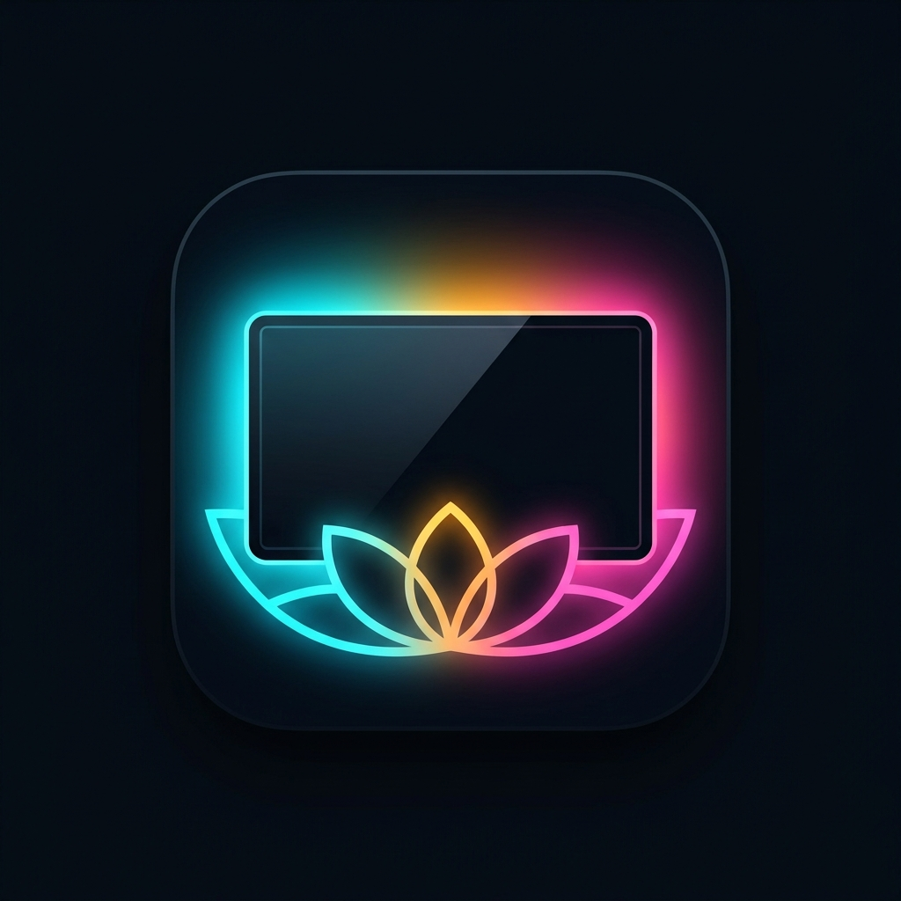
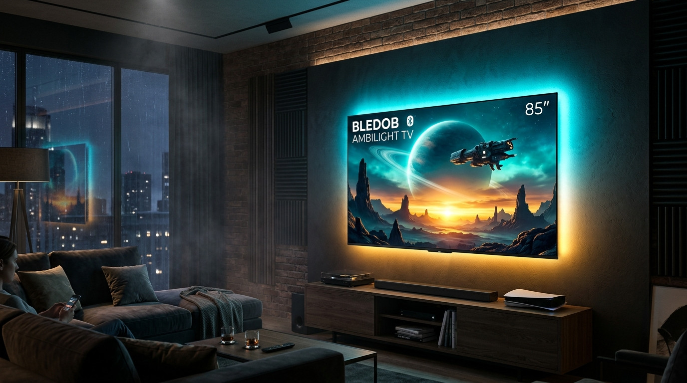
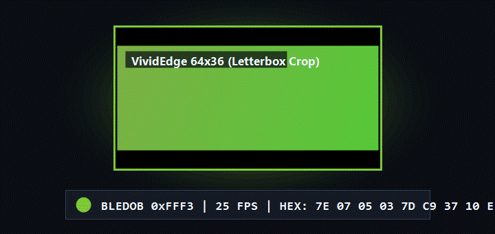
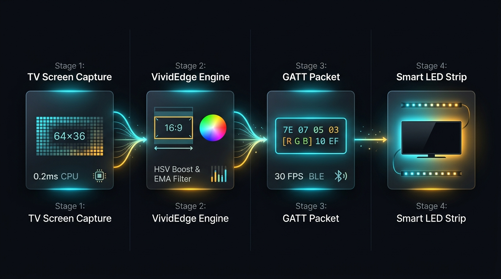
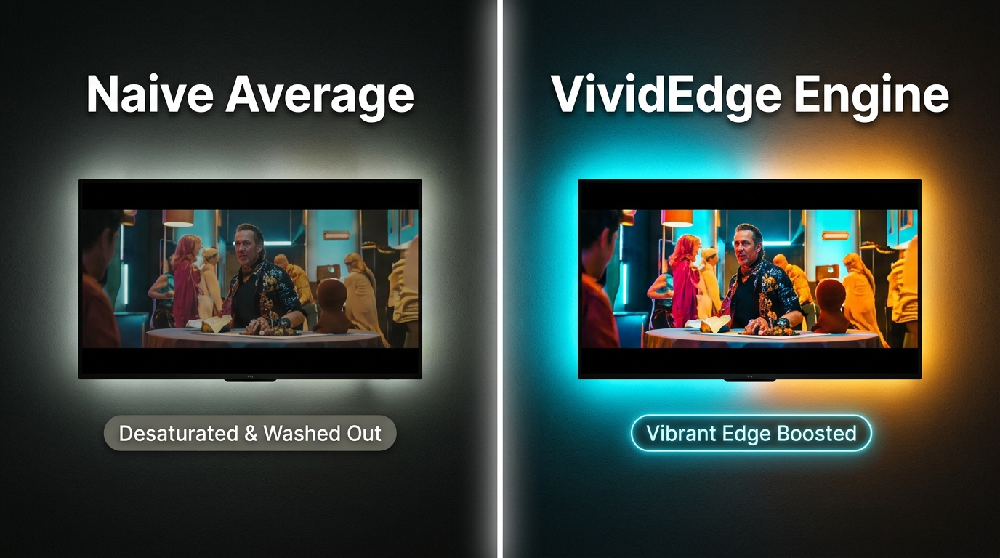
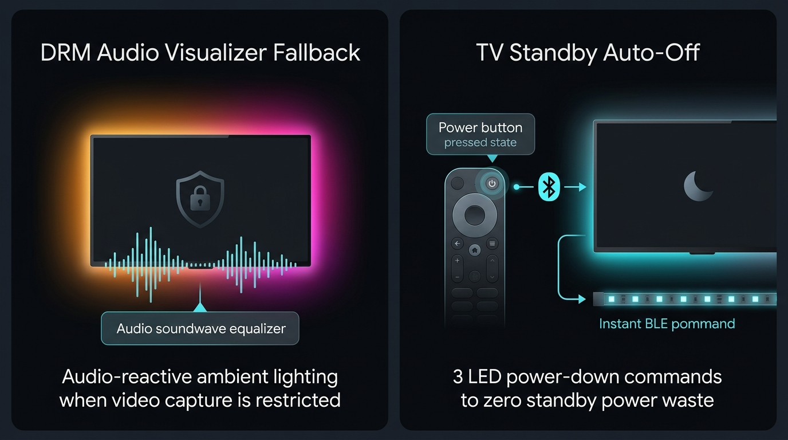
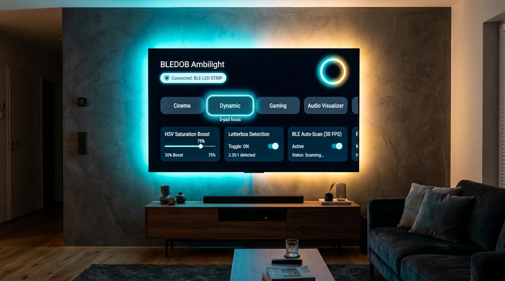
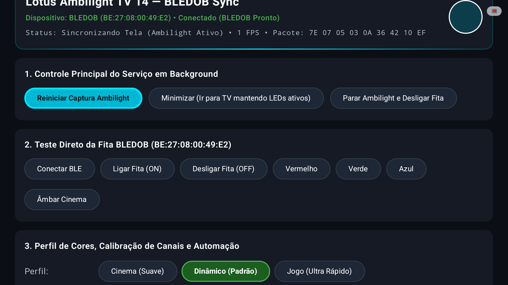

<p align="center">
  
</p>

# Lotus Ambilight TV

<p align="center">
  
</p>

Aplicativo para Android TV (compatível com Android TV 9 a 14+) que sincroniza fitas de LED Bluetooth econômicas (controladoras `BLEDOB`, `ELK-BLEDOM`, `MELK` e `LEDBLE`, que utilizam o app LotusLantern) com a imagem exibida na tela em tempo real.

O projeto dispensa placas de captura HDMI externas (como Raspberry Pi ou sync boxes caras) e câmeras apontadas para o painel. O próprio processador da TV lê os quadros da tela via `MediaProjection` em resolução reduzida (`64x36`), extrai as cores predominantes das bordas e transmite comandos via Bluetooth Low Energy (BLE) com taxa de 20 a 30 FPS.

<p align="center">
  
</p>

---

## Arquitetura de processamento

O fluxo de dados foi projetado para manter consumo mínimo de CPU e memória na Smart TV, sem causar engasgos na reprodução de vídeos em 4K HDR:

<p align="center">
  
</p>

1. **Captura em baixa resolução**: um `VirtualDisplay` de `64x36` pixels em formato `RGBA_8888` recebe os quadros da tela. A varredura de buffer completa leva menos de 0.2 ms por quadro no processador da TV.
2. **Motor de cor VividEdge**: o algoritmo descarta faixas pretas de filmes widescreen, calcula a cor nas bordas da tela e ajusta o ganho de saturação em HSV.
3. **Pacote GATT**: os valores calculados são convertidos para o protocolo binário de 9 bytes esperado pela controladora Bluetooth.
4. **Fita LED**: os pacotes são enviados via BLE sem confirmação (`WRITE_TYPE_NO_RESPONSE`), mantendo a latência baixa e o movimento suave.

---

## Cálculo de cor com VividEdge Engine

Mídias diferentes apresentam características visuais variadas: filmes em proporção 21:9 contêm faixas pretas horizontais, enquanto cenas ricas em detalhes podem diluir a média simples de pixels em tons acinzentados ou esbranquiçados.

<p align="center">
  
</p>

O `VividEdgeColorEngine` resolve essas situações com três técnicas combinadas:

- **Detecção de letterbox**: linhas superiores e inferiores com luminância abaixo do limiar de corte são ignoradas no cálculo.
- **Ponderação perimétrica**: pixels das extremidades da tela recebem peso maior do que os do centro, refletindo a iluminação que realmente toca a parede ao redor da TV.
- **Saturação e transição suave**: um fator de saturação no espaço de cor HSV reforça os tons vibrantes, enquanto uma média móvel exponencial (EMA) filtra mudanças bruscas, evitando oscilações incômodas durante cortes rápidos de câmera.

---

## DRM e sincronização de energia

<p align="center">
  
</p>

### Proteção de conteúdo (DRM)
Aplicativos de streaming que usam Widevine L1 (como Netflix, Prime Video e Disney+) ativam a proteção `FLAG_SECURE` na camada de vídeo. Nessas aplicações, o sistema operacional Android substitui o quadro capturado por uma imagem preta por questões de segurança de hardware.

Em conteúdos livres de DRM (YouTube, SmartTube, Plex, Jellyfin, Kodi, Stremio, Twitch, IPTV e jogos locais), a captura de tela funciona continuamente. Ao detectar uma sequência prolongada de quadros pretos decorrentes de DRM, o aplicativo pode comutar para o modo de visualização de áudio (analisando o sinal da sessão global da TV) ou manter uma luz ambiente estável de baixa intensidade.

### Desligamento automático em espera
O serviço monitora os eventos de sistema `ACTION_SCREEN_OFF` e `ACTION_SCREEN_ON`. Quando a TV entra em modo de espera pelo controle remoto, o aplicativo envia imediatamente o comando de desligamento para a fita de LED. Ao ligar a tela novamente, a fita acende e retoma o Ambilight de forma transparente.

---

## Protocolo Bluetooth Low Energy

O aplicativo comunica-se com a fita pelo serviço GATT `0000fff0-0000-1000-8000-00805f9b34fb` e pela característica de escrita `0000fff3-0000-1000-8000-00805f9b34fb`.

Os comandos utilizam quadros de 9 bytes iniciados por `0x7E` e finalizados por `0xEF`:

| Comando | Pacote Hex (`BLEDOB 0x07`) | Pacote Hex (`ELK-BLEDOM 0x04`) |
| :--- | :--- | :--- |
| Ligar (Power ON) | `7E 07 04 FF 00 01 02 01 EF` | `7E 04 04 F0 00 01 FF 00 EF` |
| Desligar (Power OFF) | `7E 07 04 00 00 00 02 01 EF` | `7E 04 04 00 00 00 FF 00 EF` |
| Atualização RGB | `7E 07 05 03 [R] [G] [B] 10 EF` | `7E 04 05 03 [R] [G] [B] 00 EF` |
| Ajuste de brilho (0 a 100%) | `7E 07 01 [00..64] FF FF FF 00 EF` | `7E 04 01 [00..64] FF FF FF 00 EF` |

---

## Interface e controle remoto na Android TV

A interface do aplicativo foi desenvolvida para navegação fluida por controle remoto com teclas direcionais (D-Pad), respeitando o padrão visual de televisores de tela grande:

<p align="center">
  
</p>

<p align="center">
  
</p>

Recursos disponíveis na tela de configurações:
- **Busca automática**: localiza controladoras BLE próximas que anunciem os nomes padrão (`BLEDOB`, `BLEDOM`, `MELK`, `LEDBLE`).
- **Endereço MAC manual**: permite digitar diretamente o identificador da fita (por exemplo, `AA:BB:CC:DD:EE:FF`) caso o dispositivo oculte o nome nos pacotes de anúncio.
- **Calibração de canais de cor**: botões dedicados de teste rápido (Vermelho, Verde, Azul) para diagnosticar fitas físicas que utilizem ordem invertida de fiação (`RGB`, `GRB` ou `BRG`).
- **Controle de execução**: início, pausa e minimização do serviço de segundo plano.

---

## Instalação na Android TV

1. Baixe o arquivo `.apk` mais recente na seção de [Releases](../../releases).
2. Transfira o instalador para a TV usando um pendrive, ou aplicativos de envio local como LocalSend ou Send Files to TV.
3. Abra o arquivo na TV e confirme a instalação.
4. No primeiro acesso, selecione **Buscar Fita Automaticamente** ou insira o endereço MAC da sua controladora e confirme a conexão.
5. Verifique a correspondência de cores pelos botões de teste e inicie a sincronização em segundo plano.

### Ajustes recomendados no Android TV 14 via ADB

No Android 14, o sistema operacional exibe uma caixa de confirmação sempre que uma captura de tela é requisitada e posiciona um ícone indicador de transmissão no canto superior da tela. Se você tiver acesso ADB ativado pela rede na sua TV, execute os comandos a seguir pelo computador para permitir execução direta e contínua:

```powershell
adb connect IP_DA_SUA_TV:5555

# Concede permissao permanente de captura e audio sem janelas de confirmacao
adb shell appops set com.lotus.ambilighttv PROJECT_MEDIA allow
adb shell appops set com.lotus.ambilighttv RECORD_AUDIO allow

# Impede que o sistema suspenda o servico em segundo plano por economia de energia
adb shell cmd deviceidle whitelist +com.lotus.ambilighttv

# Oculta o indicador de projecao de tela no Android TV 14
adb shell cmd device_config set_sync_disabled_for_tests persistent
adb shell cmd device_config put privacy media_projection_indicators_enabled false
```

Também é possível executar o script automatizado disponível na raiz do repositório:

```powershell
powershell -ExecutionPolicy Bypass -File .\install_and_grant_tv.ps1 -TvIpAddress "192.168.1.18"
```

---

## Compilação do código-fonte

Requisitos:
- JDK 21
- Android SDK instalado com Build-Tools 35.0.0 e plataforma API 35

Para rodar os testes unitários:

```powershell
.\gradlew.bat testDebugUnitTest
```

Para gerar o pacote de depuração (APK):

```powershell
.\gradlew.bat assembleDebug
```

O arquivo compilado é gerado no caminho:
`app/build/outputs/apk/debug/app-debug.apk`

---

## Licença

Distribuído sob a licença MIT. Consulte o arquivo [LICENSE](LICENSE) para mais informações.
